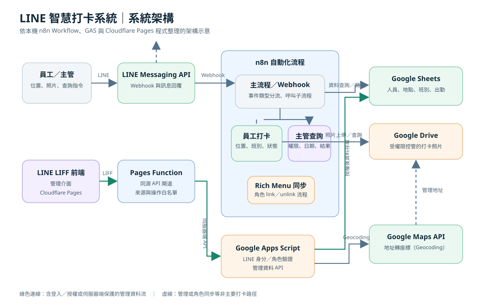
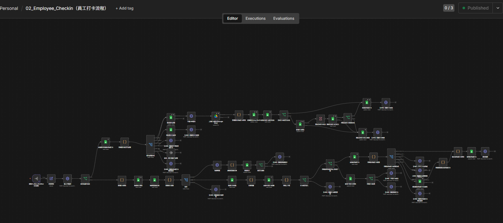

# LINE 智慧打卡系統

以 LINE 為入口的出勤流程自動化作品，整合 n8n、Google Sheets、Google Apps Script、LINE Messaging API 與 Google Maps API，處理員工位置打卡、出勤狀態判斷及主管查詢。

本作品聚焦需求分析、n8n 工作流程、跨服務 API 串接、權限與例外處理，以及 Cloudflare Pages／LINE LIFF 整合。本人負責需求、流程規劃、功能設計及測試驗證，並以 ChatGPT、Codex 等工具輔助程式撰寫、分析與文件整理；尚未完成驗證的功能會另外標示。詳見[專案角色與 AI 輔助開發方式](docs/project-role-and-ai.md)。

## 專案背景

紙本或人工彙整出勤資料容易增加管理負擔，也難以即時確認地點、打卡狀態與異常。本專案將 LINE 作為既有使用者熟悉的操作入口，以自動化流程串接位置、班別、人員資料及出勤紀錄，並提供主管查詢路徑。

## 主要功能

- 接收 LINE Webhook，按訊息類型將事件分流至員工打卡或主管查詢流程。
- 以工作地點座標及允許距離驗證打卡位置。
- 依班別時段與當日既有紀錄判斷上班、下班、遲到、早退、加班及異常。
- 管理主管查詢權限，整理今日、昨日與指定日期的出勤資料。
- 以 Rich Menu 提供員工及主管的 LINE 操作入口；角色同步流程有本機 Workflow 實作，實機驗證仍待完成。
- 專案另含 Cloudflare Pages／LINE LIFF 管理介面，透過伺服器端 API 閘道連接 GAS，詳見[管理介面技術展示](docs/technical-highlights.md#cloudflare-pages--line-liff-管理介面)。

## 系統架構

上圖為依專案程式及文件整理的**系統架構示意圖**，不是實際操作截圖。下方是員工打卡的**實際 n8n Workflow 編輯畫面**。

更多實際操作畫面請見[實際系統展示](docs/workflow-overview.md#實際系統展示)。架構資料流與元件責任另見[架構說明](docs/architecture.md)。

## 使用技術

| 領域 | 技術 | 用途 |
| --- | --- | --- |
| 使用者入口 | LINE Messaging API、LINE LIFF | 接收訊息、傳送位置、提供 LINE 內管理畫面 |
| 工作流程 | n8n、JavaScript | Webhook 分流、打卡與查詢流程、條件判斷及錯誤分支 |
| 資料 | Google Sheets、Google Drive | 人員、班別、地點、出勤資料及受限存取的照片 |
| 後端 | Google Apps Script | LINE 身分驗證、角色授權、資料讀寫及地理編碼 |
| 網頁與部署 | Cloudflare Pages、Pages Functions | LIFF 前端託管及同源伺服器端 API 閘道 |
| 地理資訊 | Google Maps Geocoding API | 地址轉換為座標；打卡位置距離由流程計算 |

## 專案成果與技術能力

- **需求轉成可維護流程**：將位置打卡、班別、重複事件、主管查詢等規則拆成 n8n 節點與子流程，並以 Data Contract 和測試計畫記錄邊界情境。
- **跨服務整合**：以 n8n 串接 LINE、Google Sheets、Google Drive，另以 Pages Function 和 GAS 支援 LIFF 管理 API。
- **例外與資料一致性設計**：涵蓋無效位置、權限拒絕、照片逾時、重複事件及寫入失敗等分支；可證明的實測案例與尚待驗證項目分列於[開發狀態](docs/project-status.md)。
- **AI 輔助開發**：使用 ChatGPT、Codex 等工具協助需求拆解、程式草擬、除錯與文件整理；本人負責需求與規則決策，輸出仍依程式、測試和實際操作紀錄核對。

詳細問題、解法與效益見[技術亮點](docs/technical-highlights.md)。

## 作品導覽

- [系統架構](docs/architecture.md)：元件責任、服務邊界與資料流。
- [實際系統展示](docs/workflow-overview.md#實際系統展示)：員工打卡、照片處理與異常、主管查詢的實際 n8n／LINE 畫面。
- [技術亮點](docs/technical-highlights.md)：問題、處理方式、效益與實作／測試狀態。
- [專案角色與 AI 輔助開發方式](docs/project-role-and-ai.md)：本人決策、AI 輔助範圍及驗證責任。
- [開發狀態](docs/project-status.md)：已實作、已實測、開發中及規劃中項目。
- [架構 SVG](assets/architecture.svg) · [流程 SVG](assets/workflow-diagram.svg)
- [安全示意 n8n JSON](examples/sample-workflow.json)：教學性最小範例，不是正式 Workflow 匯出檔。

## 開發狀態摘要

核心打卡、主管查詢及 LIFF 管理介面已有程式或 Workflow 實作，並有部分實機案例與合成資料測試紀錄。系統仍持續開發與驗證；詳細測試範圍及未完成項目集中整理於[開發狀態](docs/project-status.md)。

## 展示與安全範圍

本作品集包含實際 n8n 編輯器與 LINE 操作截圖、SVG 架構／流程示意圖及合成資料範例。截圖中的節點可能顯示 LINE API 節點路徑模板，但未顯示 Credential 值或 Token。LINE 截圖中的遮蔽與保留欄位已由專案負責人確認可公開。單次操作畫面不代表所有功能均已完成正式驗收；系統仍有部分功能持續開發與驗證，詳細狀態見[開發狀態](docs/project-status.md)。
