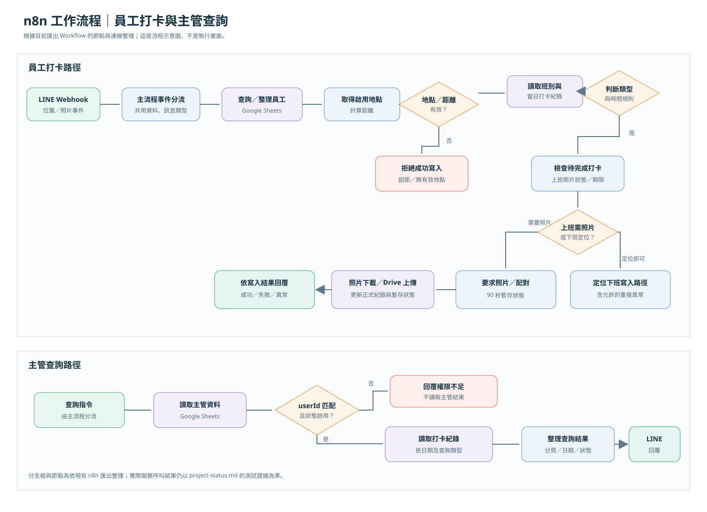
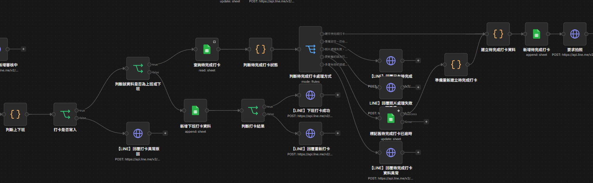
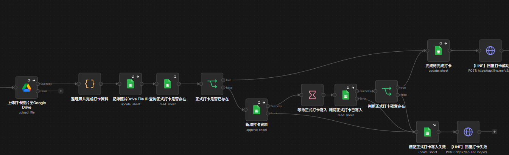
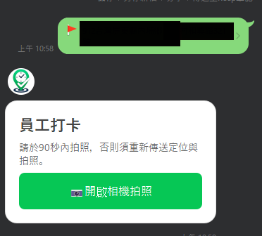
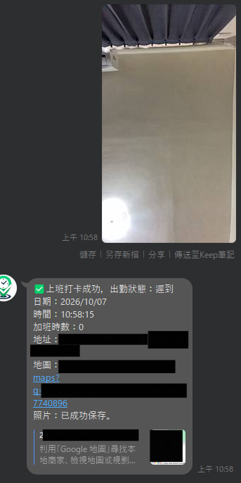
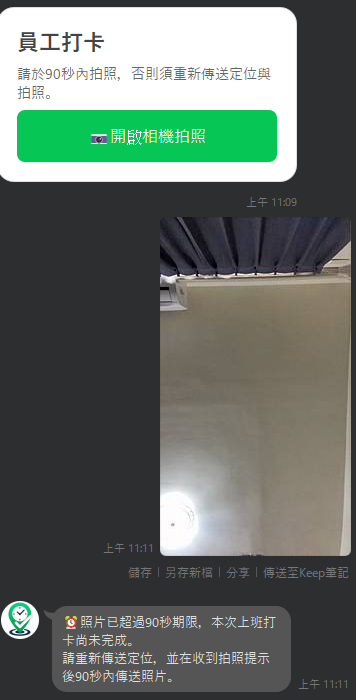
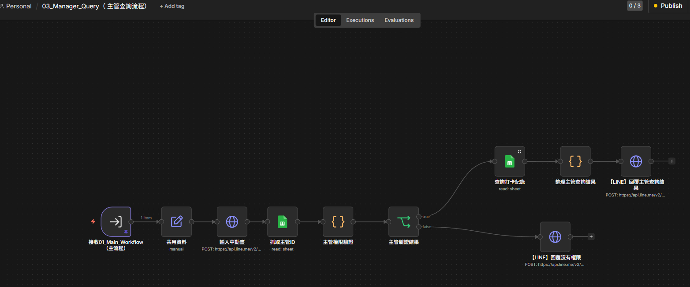
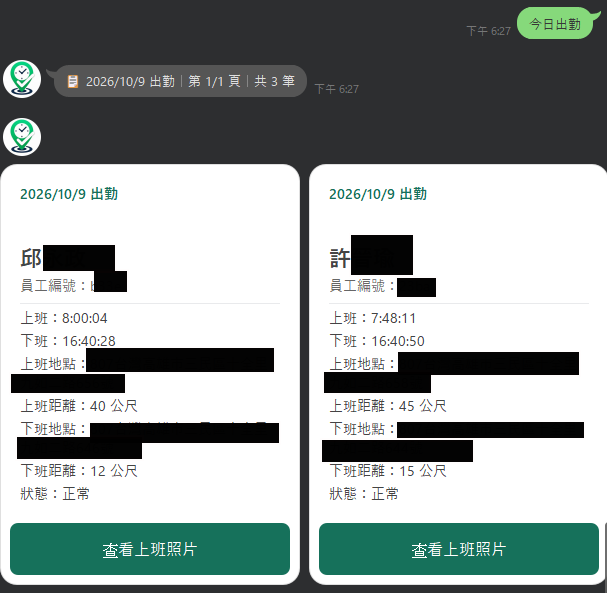

# n8n 工作流程總覽

下圖以原始 Workflow 的節點與連線為依據，將細節整理成可閱讀的高階流程。圖是文件示意圖，不是匯出畫面或執行紀錄。

上圖是**系統流程示意圖**；以下截圖則標示為**實際 n8n／LINE 操作畫面**。截圖呈現個別流程或單次操作，不代表所有功能均已完成正式驗收。截圖中的地址、地圖與識別欄位已由專案負責人確認可公開。

## 實際系統展示

### 員工打卡流程

完整員工打卡 n8n Workflow，展示 Webhook 事件分流、資料查詢、條件判斷、寫入與回覆等節點的整體串接。這是 Workflow 編輯器截圖，不是架構示意圖或執行成功證明。

員工打卡後的類型判斷、待完成紀錄檢查、寫入條件與回覆分支。畫面可見 LINE API 節點路徑模板；沒有顯示 Token 值。

### 照片處理與異常處理

照片上傳至 Google Drive 後，流程更新待完成紀錄、檢查正式打卡是否已存在，再分流至完成或失敗處理。

LINE 回覆員工需於 90 秒內完成拍照的提示畫面，展示定位後引導使用者開啟相機的互動。

LINE 對話中的照片打卡成功回覆，展示出勤狀態、照片已保存提示及相關操作資訊。截圖中的地址、地圖與識別欄位已由使用者確認可公開。

照片超過 90 秒後，LINE 提示本次上班打卡尚未完成，並要求重新傳送定位後再於期限內拍照。此圖展示逾時處理回覆，不代表其他照片失敗情境均已驗收。

### 主管出勤查詢

主管查詢流程的節點畫面，展示主管資料讀取、權限驗證、條件分流、出勤紀錄讀取及結果回覆。

LINE 主管查詢出勤結果卡片，呈現出勤日期、上下班時間、距離、狀態及查看照片入口。部分姓氏為專案負責人確認保留的展示內容。

## 主流程：事件分流

`01_Main_Workflow` 從 LINE Webhook 接收事件，整理共用欄位後依訊息／事件類型分流。定位或照片相關事件送往員工打卡子流程；查詢指令走主管查詢分支；無權限情境回覆拒絕結果。

## 員工打卡子流程

目前匯出的 `02_Employee_Checkin` 包含員工資料、工作地點、班別與當日打卡紀錄的 Google Sheets 查詢節點、距離與上下班 Code Nodes、IF／Switch 判斷、正式寫入及 LINE 回覆節點。照片路徑還包含待完成紀錄查詢、期限判斷、照片下載、Drive 上傳與正式紀錄後續更新。

主要處理順序：

1. 整理 LINE 事件資料並取得員工狀態。
2. 查詢啟用工作地點，計算位置距離；不符合條件時走失敗路徑。
3. 讀取班別及當日既有打卡資料，以時間與狀態判斷上班／下班及異常。
4. 首次定位上班依工作流程進入照片待完成流程；照片期限為 90 秒，檢查後再下載及上傳。
5. 寫入打卡資料並更新待完成狀態，依寫入結果回覆成功或失敗。

## 主管查詢子流程

1. 讀取主管資料並以 LINE userId 比對啟用狀態。
2. 未通過時走「回覆沒有權限」分支。
3. 通過後讀取打卡資料，整理日期、查詢類型與回覆內容。
4. 以 LINE Messaging API 回覆查詢結果。

員工查詢結果頁面中的照片配對會以 userId 與日期識別，不以同名或員工編號猜測照片歸屬；查詢分頁也會保留固定日期並再次要求主管權限驗證。此項由查詢 Code Node 實作及本機合成測試涵蓋。

## n8n 範例檔

`examples/sample-workflow.json` 是本作品集自行撰寫的最小化 n8n 節點結構示意，只有 Webhook 與條件分流，沒有連接任何正式服務。它刻意不含原始 Workflow 的 Credential 引用、instanceId、Webhook 路徑、資源 ID、固定執行資料或員工資訊，**不可直接匯入作為正式流程**。
